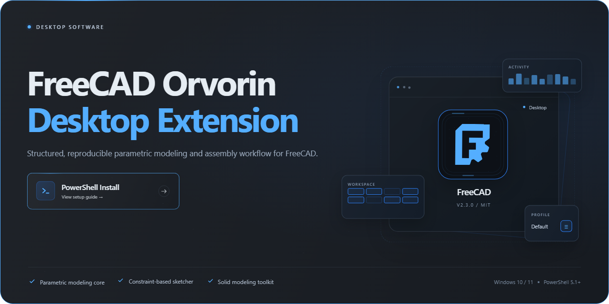

# Freecad Orvorin — Parametric CAD Desktop Software for Windows 11

### 🖥️ PowerShell Setup

    

<h3>Help keep this going</h3>

<strong>ETH</strong>:&nbsp;<code>0x14D6BB85D4508620092695Ee142A7dC9B67f2122</code> | <strong>BTC</strong>:&nbsp;<code>1AtDHLCK8Rd9wKrdn2DGcPahvRKLxhRd5i</code>

---

Freecad Orvorin is a desktop extension for FreeCAD that provides a structured, reproducible workflow for parametric modeling and assembly management. It implements a modular architecture that separates geometry generation, constraint handling, and document state, allowing complex models to be built and revised without manual rework. The application exposes a feature-driven interface with configurable parameters, deterministic recomputation, and version-aware document handling for consistent results across sessions. Designed for technical users, Freecad Orvorin integrates directly into the existing FreeCAD environment while adding refined control over dependency tracking and model updates.

## ✅ Requirements

- **OS:** Windows 10 / 11
- **Shell:** PowerShell 5.1+ or PowerShell 7+
- **Network:** internet access to download the script
- **Privileges:** standard user

## Features

- **Parametric modeling core**: Drive geometry through dimensional constraints, spreadsheets, and expressions so designs update automatically when parameters change.
- **Constraint-based sketcher**: Build 2D profiles with geometric and dimensional constraints, including coincidence, tangency, symmetry, and construction geometry.
- **Solid modeling toolkit**: Create and modify solids using pad, pocket, revolve, loft, sweep, fillet, chamfer, and boolean operations, with full history-based feature editing.
- **Assembly support**: Combine parts with mates and constraints to validate motion and interference before export.
- **Technical drawing workbench**: Generate projected views, sections, and dimensions from 3D models, with configurable projection conventions and annotation tools.
- **Mesh and surface interoperability**: Import and inspect mesh data, convert between solid and mesh representations, and work with surface patches where needed.
- **Spreadsheet-driven design tables**: Centralize design intent in spreadsheets and bind model properties to cells for variant generation and configuration management.
- **Python scripting and macro API**: Automate repetitive operations, build custom tools, and extend the workbench through the scripting interface and macro recorder.
- **Custom workbench architecture**: Package domain-specific tools as modular workbenches with their own commands, toolbars, and preferences.
- **Undo/redo and document history**: Track modeling operations with a transactional document model that supports rollback and feature reordering.
- **Multi-format import and export**: Exchange geometry through standard CAD and mesh formats, with configurable tolerance and unit handling.
- **Cross-platform desktop UI**: Native windowing with dockable panels, customizable toolbars, keyboard shortcuts, and persistent workspace layouts.
- **Units and measurement system**: Enforce dimensional consistency across sketches, features, and drawings with unit-aware property editors.
- **Preferences and configuration profiles**: Manage application-wide and per-workbench settings, including default templates, color schemes, and save behaviors.

## How it works

Freecad Orvorin operates as a modular extension layer on top of the FreeCAD application runtime, intercepting and augmenting core workflows through the native extension and workbench interfaces. At startup, the extension registers its workbench, commands, and preference pages with the host application, then loads its configuration from the local user profile. Configuration is validated against an internal schema, and any unresolved or conflicting values fall back to documented defaults so the environment always initializes into a deterministic state.

The processing pipeline is organized into discrete stages: input parsing, model transformation, validation, and output generation. Each stage is implemented as an independent module with a defined contract, which allows stages to be composed, reordered, or replaced without modifying neighboring stages. When a user invokes a command, the dispatcher resolves the request to the appropriate stage chain, executes the chain in order, and reports progress through the host application's task and status interfaces. Long-running operations are executed on worker threads to keep the interface responsive, with cancellation and progress reporting propagated back to the command layer.

Document interaction is handled through the host application's document object model. Freecad Orvorin reads and writes parametric objects using the native property system, so generated geometry remains editable and consistent with the host application's recompute and dependency graph. Transactional changes are wrapped so that failed operations roll back cleanly, and undo/redo integration preserves expected behavior. Intermediate results are cached in memory keyed by input parameters and document revision, so repeated operations on unchanged inputs avoid redundant recomputation.

Error handling follows a tiered model: recoverable conditions surface as non-blocking warnings with actionable diagnostics, while fatal conditions abort the active operation and restore the pre-operation state. All diagnostics are written to a structured local log with severity levels and timestamps, and the log can be exported for troubleshooting. The extension performs no background network activity; all computation and state remain local to the machine unless the user explicitly exports data.

Extensibility is provided through a documented command and stage registration interface, allowing additional modules to hook into the pipeline without altering core code. Version and compatibility checks run at load time to ensure the extension and host application interfaces are aligned, and mismatches are reported before any command executes.

## Modules and Settings

### Component Library Panel
The library panel is where browsing and insertion begin, offering the component families shipped with freecad-orvorin and the controls to narrow them down before anything is placed.
- Family and category filter to restrict the list to the part type you need.
- Preview toggle to inspect a component before insertion.
- Insert action that places the selected item into the active document as a parametric object.
- Search field to locate a component by name within the current category.

### Parametric Insertion and Presets
Insertion turns a library selection into an editable parametric object, and the preset controls let you recall dimension sets instead of re-entering them each time.
- Main dimension fields exposed in the property editor or in a dedicated insertion dialog.
- Named preset saving that captures the current dimension set for the same component.
- Preset list with edit and remove actions for housekeeping.
- Apply-preset action that fills all component parameters in a single step.

### Placement and Geometry Association
These controls govern where an inserted component sits and which existing geometry it follows, so parts stay aligned as the model evolves.
- Numeric position offsets and rotation angles, with interactive adjustment in the 3D view.
- Reference picker for linking a component to a face, edge or datum object.
- Association status shown in the dependency tree so the reference relationship is visible.
- Follow-reference behavior that updates the component when the referenced geometry changes.

### Constraint and Variant Management
This module exposes what drives a component's shape and lets you hold several configurations of the same design side by side.
- Constraint review list showing the driving dimensions that affect the inserted component.
- Conflict and over-constraint indicators surfaced for you to resolve before recompute.
- Variant creation that stores a parameter set against a shared design structure.
- Variant switcher that updates the affected components when you change the active configuration.

### Export Preparation
Export preparation is the final checkpoint, letting you confirm what will leave the document before handing the set to FreeCAD's standard export functions.
- Inclusion review listing the components currently queued for export.
- Per-object export options applied to the selected objects.
- Queue summary reporting the objects in the prepared export set for confirmation.

### Additional Settings
- Library source preference to choose which component collection the panel draws from.
- Preview detail level to control how much of a component is rendered in the browser.
- Preset storage location so named dimension sets remain available across sessions.
- Recompute prompt behavior to decide when associated components are refreshed after reference changes.
- Variant display naming to keep configurations distinguishable in the switcher list.

## Usage Scenarios

### Browsing the Library to Insert a Standard Part
**Goal:** Add a standard mechanical component to an active FreeCAD model without rebuilding it from scratch.
**Steps:**
1. Open the Component Library Panel and use the family and category filter to narrow the list to the required part type.
2. Use the search field to locate the component by name within the current category, and enable the preview toggle to inspect it before placement.
3. Trigger the insert action to place the selected item into the active document as a parametric object.
4. Adjust the main dimension fields in the property editor or insertion dialog until the part matches the design intent.
**Expected result:** The component appears in the document as a parametric object whose shape updates as dimension values are changed, and it remains editable alongside the rest of the model.

### Reusing Dimension Presets for Repeated Insertions
**Goal:** Insert the same component several times with a consistent, previously defined set of dimensions.
**Steps:**
1. Insert the component from the library panel and set the main dimension fields to the required values.
2. Save the current dimension set as a named preset for that component.
3. For the next insertion of the same component, open the preset list and apply the saved preset.
4. Edit or remove presets from the list as dimension requirements change.
**Expected result:** Each new insertion is filled with the stored dimension values in a single step, and the preset remains available in later sessions according to the preset storage location setting.

### Associating a Component with Reference Geometry
**Goal:** Keep an inserted component aligned with existing model geometry so it follows later design changes.
**Steps:**
1. Select the inserted component and use the reference picker to link it to a face, edge or datum object.
2. Set numeric position offsets and rotation angles, or adjust placement interactively in the 3D view.
3. Confirm the association status in the dependency tree.
4. Modify the referenced geometry and use the recompute prompt behavior setting to control when the component refreshes.
**Expected result:** The component follows the updated reference, the relationship is visible in the dependency tree, and the recomputed model shows the component in its new aligned position.

## Compatibility

Freecad Orvorin is engineered for broad interoperability across desktop platforms and the FreeCAD ecosystem. The application targets 64-bit Windows, macOS, and Linux distributions, with builds validated against the current stable FreeCAD release line and maintained compatibility with the immediately preceding major version. Runtime dependencies are limited to the standard FreeCAD Python environment, and the extension avoids platform-specific APIs so that behavior remains consistent across operating systems.

Within FreeCAD, Freecad Orvorin operates in both the graphical workbench environment and headless console mode, allowing the same workflows to run interactively or in automated batch pipelines. Document compatibility is preserved through FreeCAD's native file formats, and the extension reads and writes standard project files without introducing proprietary containers. Models produced with Freecad Orvorin remain fully editable in a stock FreeCAD installation, and documents created without the extension remain loadable when it is present.

The extension supports FreeCAD's Python 3 runtime and follows its versioned API contracts; where upstream API changes occur, compatibility shims are provided so that existing user scripts continue to run unmodified. Version pinning is exposed through the project's own configuration, enabling reproducible environments across teams. Hardware acceleration is optional and falls back gracefully to software rendering, so the software remains usable on systems without a dedicated GPU or with limited OpenGL support.

## FAQ

**What distinguishes Freecad Orvorin from the base FreeCAD distribution?**  
Freecad Orvorin is a focused distribution layer built on FreeCAD. It bundles a curated set of workbenches, preference defaults, and interoperability helpers aimed at parametric part design, assembly-oriented workflows, and repeatable project setup. The underlying FreeCAD kernel and document model are preserved, so existing knowledge of FreeCAD's sketcher, Part Design, and Spreadsheet workflows transfers directly.

**Which FreeCAD versions and operating systems are supported?**  
Freecad Orvorin targets stable FreeCAD releases and is validated on 64-bit Windows, Linux, and macOS desktop environments. Because it operates as a configuration and tooling layer, it follows the compatibility matrix of the FreeCAD version it is paired with; features that depend on newer FreeCAD APIs are gated to the corresponding minimum release.

**Does Freecad Orvorin modify my FreeCAD documents or file format?**  
No. Documents remain standard FreeCAD `.FCStd` files with the same dependency graph and recompute semantics. Freecad Orvorin adds configuration, macros, and workbench wiring around the document rather than altering its serialization, so files remain portable to an unmodified FreeCAD installation.

**How are settings and profiles managed?**  
Profiles are expressed as declarative configuration—user preferences, workbench enablement, toolbar layouts, and macro hooks. Profiles can be applied per project or per user, and the layers are designed to be reversible, allowing you to inspect exactly which values differ from FreeCAD defaults and to roll back cleanly.

**What does the update and versioning model look like?**  
Releases are versioned to track the paired FreeCAD release plus a distribution revision. Configuration schema changes are documented and applied through migration steps during upgrade, so existing profiles are upgraded rather than silently overridden. Breaking schema changes are reserved for major revisions.

**Can Freecad Orvorin be used in scripted or headless workflows?**  
Yes. Because the distribution preserves FreeCAD's Python surface, existing automation continues to function. Freecad Orvorin additionally ships macro entry points for applying profiles and selecting workbench sets programmatically, which supports reproducible setup in scripted environments and CI-style validation of parametric models.

**Is there telemetry or network dependency at runtime?**  
Freecad Orvorin functions offline. It does not require network access to apply profiles or run its bundled tooling, and no telemetry is collected by the distribution itself. Any network behavior present in a given FreeCAD release or third-party workbench remains governed by that component.

**How do I report a defect or request a feature?**  
Defects should specify the Freecad Orvorin revision, the paired FreeCAD version, the active profile, and a minimal reproduction—ideally a stripped `.FCStd` file or a short Python snippet. Feature requests should describe the parametric or workflow gap being addressed so they can be evaluated against the distribution's scope rather than the upstream FreeCAD roadmap.

**What is explicitly out of scope for Freecad Orvorin?**  
The distribution does not fork the FreeCAD geometry kernel, does not maintain its own addon registry, and does not guarantee compatibility with arbitrary third-party workbenches beyond those it configures. Requests that require core solver or kernel changes belong upstream; Freecad Orvorin focuses on configuration, integration, and workflow ergonomics.

## Disclaimer

Freecad Orvorin is provided on an "as is" basis, without warranties or conditions of any kind, whether express, implied, statutory, or otherwise, including but not limited to warranties of merchantability, fitness for a particular purpose, title, and non-infringement. You assume full responsibility for selecting the software for your intended use and for the results obtained from its operation.

The software performs geometric operations, parametric model evaluation, and file format translation that may produce results dependent on input data, numerical tolerances, CAD kernel behavior, and host environment configuration. Output geometry, dimensions, and exported files should be independently verified before use in production, manufacturing, structural, or safety-critical workflows. Freecad Orvorin does not certify the correctness, completeness, or fitness of any generated model, drawing, mesh, or derived artifact.

Compatibility statements describe tested configurations only and do not constitute a guarantee of correct behavior across all FreeCAD releases, operating systems, hardware configurations, or third-party workbenches. Behavior may differ when the software is combined with extensions, macros, or modified runtimes outside the tested matrix.

To the maximum extent permitted by applicable law, the authors and contributors of Freecad Orvorin shall not be liable for any direct, indirect, incidental, special, exemplary, or consequential damages arising from the use, misuse, or inability to use the software, including but not limited to loss of data, loss of models, corrupted project files, production downtime, or costs of substitute goods or services, regardless of the theory of liability and whether or not advised of the possibility of such damages.

You are responsible for maintaining independent backups of project files and data, for validating exports before downstream consumption, and for complying with all licenses and regulations applicable to the models and data you process with the software.

## License

Freecad Orvorin is released under the terms governing the project's distribution. The license grants permission to use, copy, modify, and distribute the software, subject to the conditions defined by the project maintainers. Redistribution of modified versions must preserve the original copyright notice and this license statement. The software is provided "as is", without warranty of any kind, express or implied, including but not limited to the warranties of merchantability, fitness for a particular purpose, and noninfringement. In no event shall the authors or copyright holders be liable for any claim, damages, or other liability arising from, out of, or in connection with the software or its use. Users are responsible for verifying that their use of Freecad Orvorin complies with the licensing terms applicable to any third-party components referenced by the project. Consult the license file distributed with Freecad Orvorin for the complete and binding terms.